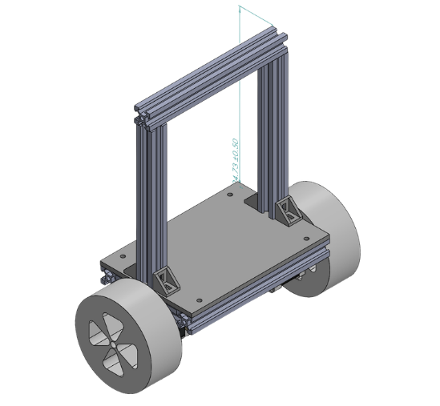

# Self-Balancing Robot

A two-wheeled inverted-pendulum robot that keeps itself upright using a closed-loop PID controller. It was built as a mini summer project in 2025, with an ESP32 for control and a BNO055 for orientation sensing. The gains were tuned wirelessly over Bluetooth, using an empirical Ziegler–Nichols-style procedure.

## Why this project

A two-wheeled robot is an unstable system. Left alone, it falls over, so the controller has to keep correcting the tilt. The project covers the full control loop: sensing, control and actuation. It was also my first hands-on look at how much tuning matters for a real plant.



## Hardware

| Component | Details |
|---|---|
| Microcontroller | ESP32 WROOM |
| IMU | Bosch BNO055 (9-DOF, on-chip sensor fusion) |
| Motors | NEMA 17 MOTOR |
| Motor driver | DRV8825 Stepper Driver |
| Frame | Aluminium extrusion frame on a flat base plate, designed in CAD (Solidworks) |
| Wireless link | ESP32 Bluetooth [Classic / BLE], used for live PID tuning and telemetry |

**Pin assignment**

| Signal | GPIO |
|---|---|
| Left STEP / DIR | 26 / 25 |
| Right STEP / DIR | 14 / 27 |

## Control Architecture

1. **Measurement.** The BNO055 provides the chassis tilt angle (Euler Z axis).
2. **Setpoint.** The upright reference is captured at start-up, so the robot must be held upright when powered on.
3. **Error.** `error = setpoint − tilt`. Errors within a configurable deadband are set to zero and the integral term is cleared, which prevents the motors from hunting around the upright position.
4. **PID law.** `output = Kp·e + Ki·∫e dt + Kd·de/dt`.
5. **Actuation.** The output is limited to a maximum step rate and applied to both steppers in opposite directions, so the wheels drive toward the direction of the lean.

## Tuning Methodology

Gains were adjusted live over Bluetooth in two stages.

**Stage 1: Manual iteration.** Kp, Ki and Kd were adjusted by hand and the response observed, giving a stable baseline.

**Stage 2: Empirical Ziegler–Nichols-style tuning.** Each term was tuned in sequence, then the cycle was repeated:

1. **Kp:** with Ki = Kd = 0, increase Kp until the robot responds firmly and begins to oscillate, then reduce slightly.
2. **Ki:** add integral action to remove steady lean or drift, without introducing slow oscillation.
3. **Kd:** add derivative action to damp oscillation and overshoot after disturbances.
4. **Iterate:** repeat the sequence, since the terms interact, until the response is stable.

This follows the principle behind Ziegler–Nichols (locate the onset of sustained oscillation under proportional control, then tune around it) without applying the table formulas directly.

## Repository

```
├── self_balancing.ino    # ESP32 firmware
├── motor-test.ino        # test
└── README.md
```

## Getting started

1. Wire the BNO055 to the ESP32 over I²C, and the motor driver to the ESP32 pins defined in the sketch.
2. Open the `.ino` file in the Arduino IDE with ESP32 board support installed.
3. Install the required libraries: `[Adafruit BNO055, Adafruit Unified Sensor, ...]`.
4. Set the initial PID gains at the top of the sketch.
5. Flash it, hold the robot upright, power on and release.
6. Connect over Bluetooth to adjust the gains live.

## Tech stack

`ESP32` · `BNO055` · `PID control` · `Ziegler–Nichols (empirical)` · `Bluetooth` · `C/C++`

## Team

Laksh Jain, Diya Jain (mechanical design) · Vaibhavi Rajput, Pranveer Singh (electronics) · Dhriti Dhall (control firmware and tuning)
